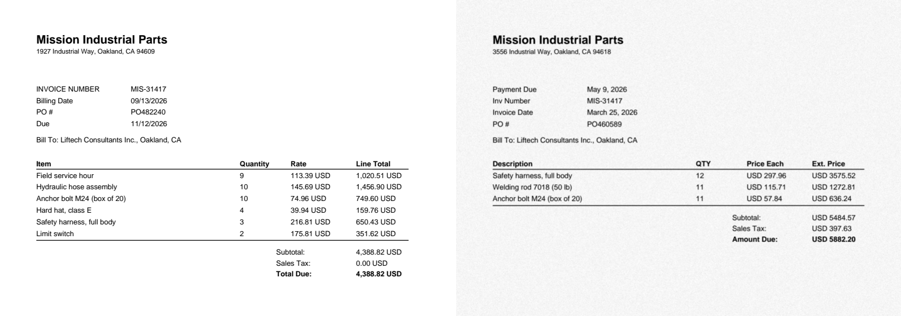

# docflow: messy invoice PDFs in, clean validated tables out

[](https://github.com/vincentweikum/docflow/actions/workflows/ci.yml)

A document data pipeline that reads invoice PDFs from many different vendors, pulls out the header fields and line items, checks the math and the business rules, and writes clean CSV tables plus a **review queue** for anything a person should look at. Scanned, image-only PDFs go through OCR automatically.

The goal isn't to be perfect, it's to **never be silently wrong.** Every document either passes every check or goes to review with a reason.



## Results

Scored against an answer key for every document ([`reports/evaluation.json`](reports/evaluation.json)):

| | Clean PDFs | Scanned PDFs (OCR) |
|---|---|---|
| Documents | 250 | 85 |
| Header field accuracy | 100% | **99.7%** |
| Line items exactly right | 100% | **95.3%** |
| Planted problems sent to review | 48 of 48 | **18 of 18** |
| Clean documents wrongly sent to review | 0 of 202 | 4 of 63 (all four were real OCR misreads) |
| **Wrong data auto-approved** | **0** | **0** |

**Be skeptical of the clean column.** The extractor was developed against the clean PDFs, so 100% there mainly shows it handles every layout and label it was built for. **The scanned set is the honest test:** those copies were rotated, blurred and noised, have no text layer at all, and the extractor was never tuned on OCR output beyond the two fixes described below. On that set it misread 5 documents, and all 5 were caught by validation and routed to review instead of being approved.

## What makes the documents messy

The test set is synthetic, since real invoices can't be shared, but it's built to be annoying the way real ones are:

- **5 layouts across 9 vendors:** label-value tables, two fields per line, right-aligned headers, compact blocks
- **Labels that change by vendor:** `Invoice #`, `Inv Number:`, `Bill No.` (while `Bill To:` is not a bill number), `Due` (while `Total Due` is not a due date)
- **4 date formats** (`03/04/2026`, `March 4, 2026`, `2026-03-04`, `04-Mar-2026`) and **3 money formats** (`$1,234.50`, `1,234.50 USD`, `USD 1234.50`)
- **About 1 in 5 documents has a planted problem:** a total that doesn't add up, line items that don't sum to the subtotal, a missing PO, a due date before the invoice date, or a duplicate of an earlier invoice
- **Scanned copies** of 30% of the set: rasterized, rotated up to 1.5 degrees, blurred and noised, saved as image-only PDFs

## How it works

```
PDF ──► text layer? ──yes──► pdfplumber text
            │no
            └──────────────► OCR (Tesseract)
                                  │
                                  ▼
                 extract: label patterns for header fields,
                 line item parser, totals, date/money normalizers
                                  │
                                  ▼
                 validate: required fields, line math, subtotal,
                 subtotal + tax = total, dates, PO format, duplicates
                                  │
                   ┌──────────────┴──────────────┐
                   ▼                             ▼
     invoices.csv + line_items.csv        review_queue.csv (with reasons)
```

**Using the document's own math to fix OCR.** OCR often reads a `7` as `L`, `i`, or `re`. Every line item carries its own arithmetic (quantity × unit price = amount), so when the quantity is unreadable or doesn't check out, the pipeline recovers it from amount ÷ unit price and marks the line as `repaired`. If the numbers still don't reconcile, the document goes to review.

**Fixes made after looking at OCR failures** (both covered by tests): quantities garbled into letters, and a scan where the column header row was unreadable, so the pipeline now falls back to the first line that looks like a line item. A third OCR issue, `PO492747` read as `PQ492747`, is caught by a PO format rule rather than "fixed", because guessing at an ID is how bad data gets approved.

## Run it

```bash
pip install -r requirements.txt          # also needs Tesseract: apt install tesseract-ocr / brew install tesseract
make data                                # 250 invoices + answer key + scanned copies
make run                                 # extract + validate -> out/
make evaluate                            # score both sets -> reports/evaluation.json
make test                                # 19 unit and end-to-end tests
```

CI runs the tests and the full evaluation on every push, and **fails the build if any wrong data gets auto-approved.**

A clean run over the 250 text PDFs takes under 2 seconds. Sample inputs are in [`samples/`](samples/).

## Stack

Python, pdfplumber, Tesseract OCR, pypdfium2, ReportLab (test data), pandas, pytest, GitHub Actions
